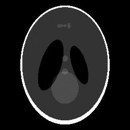

# Sparse-View CT Image Reconstruction

Reconstructing 2D images from **computed tomography (CT) projection measurements** using iterative numerical optimization in **MATLAB / GNU Octave**.

This project was developed as part of a university programming/numerical-computing assignment. The main implementation is in [`reconstruct.m`](reconstruct.m); the driver, reference operators, evaluation utilities, and practice inputs are part of the course-provided testing environment.

## Example reconstructions

The following PNGs were produced from the provided practice examples. They illustrate the output; they are **not** a claim of benchmark accuracy on unseen datasets.

| Dense-view example (Tier 2) | Sparse-view example (Tier 4) |
|:--:|:--:|
|  |  |

Additional outputs are in [`examples/`](examples/).

## What the implementation does

The CT measurement model can be written as `b = A x + noise`, where `b` is the measured sinogram and `x` is the unknown image. Instead of forming the potentially large projection matrix `A`, the implementation caches pixel-to-detector mapping information for efficient repeated forward and adjoint projections.

The reconstruction pipeline adapts to problem size and sampling density:

- **Conjugate gradient** with Tikhonov regularization for dense-view cases.
- **SIRT and SART** iterations for selected reconstruction scenarios.
- **Total-variation regularization** using a primal-dual hybrid gradient approach for sparse-view cases.
- Post-processing including **median, bilateral, and anisotropic smoothing**, with intensity constraints.

See `reconstruct.m` for the full implementation and its case selection logic.

## Project structure

```text
reconstruct.m        Main reconstruction implementation
run_tier.m           Provided experiment runner
operators/           Provided forward / adjoint operators
utils/               Provided input/output and visualization helpers
evaluation/          Provided scoring functions (PSNR / SSIM)
data/practice/       Provided practice inputs and reference images
examples/            Selected reconstructed PNG images
Dockerfile           GNU Octave environment
docker-compose.yml   Containerized run configurations
Makefile             Convenience tasks (make + Docker)
```

## Running a practice reconstruction

The simplest cross-platform option is **Docker Desktop** (with Docker Compose).
From the repository root, run:

```sh
docker compose run --build --rm run
```

This runs the default Tier 1 practice example and writes an output image and report in `results/`. To run another tier, such as Tier 3:

```sh
docker compose run --build --rm run-tier octave --no-gui --no-window-system --eval "tier=3; use_practice=true; run_tier"
```

If you have `make` and Docker installed, shortcuts are also available:

```sh
make p1
make p2
make p3
make p4
```

You can also run the code directly from GNU Octave if its supported dependencies and paths are available, but the Docker setup matches the provided environment.

## Attribution and scope

This repository distinguishes my reconstruction implementation (`reconstruct.m`) from the **university-provided starter package**, which includes the test harness, helper code and example datasets. The provided components are retained to demonstrate how the implementation is evaluated.

> **Publication reminder:** Confirm that your course permits sharing the starter code and practice datasets before making the repository public. Otherwise remove or replace those materials with examples you have permission to distribute.

## Notes

- Practice examples include reference images for local evaluation; competition datasets are not included.
- Benchmark scores have not been independently re-run for this portfolio package; output images are included as illustrations only.
